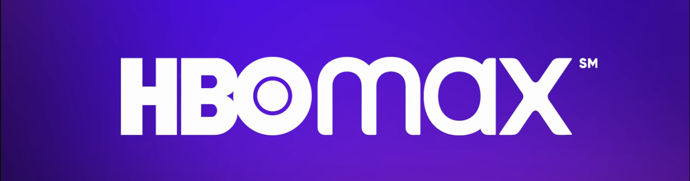
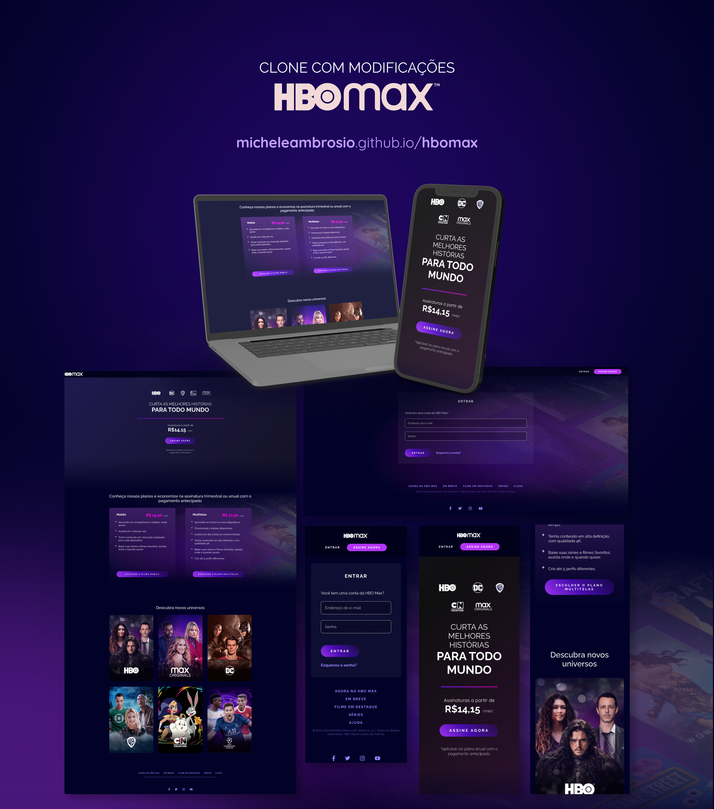

<h1 align="center">Site HBO Max</h1>
<h4 align="center">Clone com modificações e melhorias semânticas</h4>

  Este projeto é um clone da interface do site <a href="https://www.hbomax.com/br/pt">HBO Max</a>, desenvolvido como desafio final da Trilha de CSS da <a href="https://dio.me">Digital Innovation One (DIO)</a>.

  O objetivo foi reproduzir a interface original, aplicando conceitos de HTML5 semântico, CSS moderno, animações e responsividade.

## 📎 Sumário

- [✨ Features](#features)
- [📦 Temas abordados](#topics)
- [🏆 Desafio](#challenges)
- [🌈 Demonstração](#demo)
- [👨‍💻 Autor](#author)

<h2 id="features">✨ Features</h2>

- Menu de navegação semântico com `<header>` e `<nav>`
- Cabeçalho com animação de gradiente
- Cards com os planos de assinatura animados (efeito 3D)
- Lista de filmes e séries disponíveis na plataforma
- Formulário de login com validação nativa (`required`, `minlength`)
- Rodapé com links importantes organizados em listas semânticas
- UI Responsiva (desktop, tablet e mobile)

*As features são visuais, não possuindo integração com nenhuma API. O intuito do projeto é reproduzir a interface do site original, com algumas modificações e melhorias de código.*

<h2 id="topics">📦 Temas abordados</h2>

O projeto possui como intuito aplicar os conceitos abordados na Trilha de CSS da <a href="https://dio.me">DIO</a>.

Recursos CSS presentes no projeto:

- Fundamentos do CSS
- Variáveis CSS (`:root`)
- Grid Layout
- Flexbox
- Responsividade com Media Queries
- Pseudo-elementos (`::before`, `::after`, `::marker`)
- Pseudo-classes (`:hover`, `:invalid`, `:has`)
- Transformações 2D e 3D
- Transições e animações (`@keyframes`)
- Tratamento de campos inválidos no formulário

Recursos de HTML5 semântico utilizados:

- `<header>`, `<nav>`, `<main>`, `<section>`, `<article>`, `<footer>`
- `<ul>` e `<li>` para listas de navegação
- Atributos de acessibilidade (`aria-label`, `aria-labelledby`, `aria-current`)
- Atributos de formulário (`required`, `autocomplete`, `minlength`)
- Meta tags para SEO (`description`)

<h2 id="challenges">🏆 Desafio</h2>

Como parte do desafio final da Trilha de CSS da DIO, o objetivo era reproduzir o clone do site HBO Max, colocando em prática todos os conceitos aprendidos ao longo da formação.

Neste projeto, além de reproduzir a interface, foram implementadas **melhorias de semântica HTML5 e acessibilidade**, tornando o código mais profissional e pronto para o mercado.

