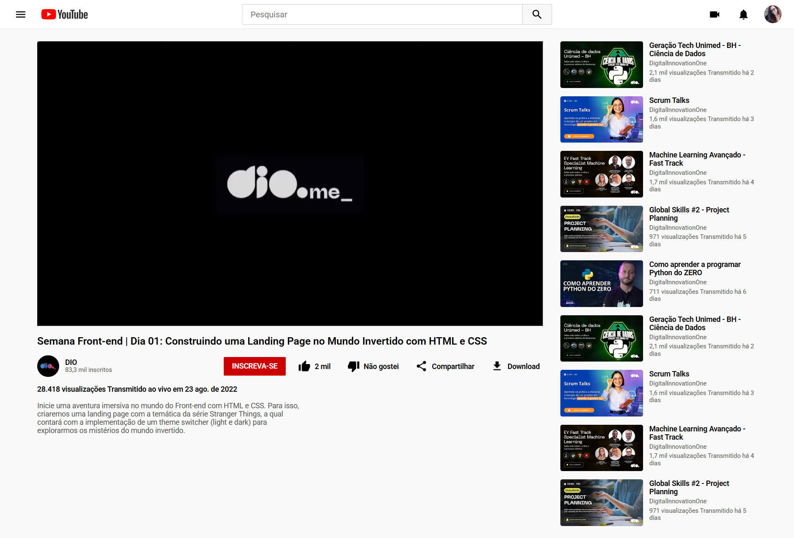

# Desafio 02: Clonando a Página do YouTube com CSS

Bem-vindo(a) ao segundo desafio da Trilha de CSS da DIO! Neste desafio, você vai colocar a mão na massa e clonar a página do YouTube, colocando em prática todos os conceitos aprendidos, principalmente sobre **Flexbox**.

## 📝 Sobre o Desafio

Este projeto foi construído **do zero**, desde a estrutura HTML até a estilização CSS, aplicando os conhecimentos adquiridos ao longo da trilha. O objetivo foi recriar a interface da página de reprodução de vídeo do YouTube, focando em:

- **Flexbox:** Utilizado para alinhar o Header (Logo, Busca, Ícones), a barra de ações do vídeo (Like, Share, etc.) e a Sidebar (Cards de vídeos recomendados).
- **Posicionamento:** Uso de `position: sticky` no cabeçalho para que ele fique fixo no topo ao rolar a página.
- **Responsividade:** Criação de um `@media query` para que, em telas menores, a Sidebar vá para baixo do vídeo principal.
- **Organização de Arquivos:** Estrutura de pastas com `assets` para imagens, `index.html` e `style.css`.
- **Ícones SVG:** Uso de ícones vetoriais direto no HTML para os botões de Like, Deslike, Compartilhar e Download.

[Link do Figma](https://www.figma.com/file/3PiokoJj9IhGDnNiWAJbz7/DIO---Desafio-02?node-id=2%3A6) contendo o protótipo do desafio para que você possa se basear.

*Observações: para aplicar os textos em gradiente, utilize a propriedade CSS `background-clip`, porém, para funcionar em alguns navegadores, é necessário utilizar a propriedade `-webkit-background-clip: text;`*

## 🚀 Resultado Final

*(Substitua `assets/preview.png` pelo print da sua tela finalizada, se desejar)*

Caso tenha alguma dúvida, ou queira comparar o resultado do desafio que você fez, nós temos o site finalizado na branch *final*. Basta alterar a branch do projeto utilizando o comando `git checkout final` no seu terminal.