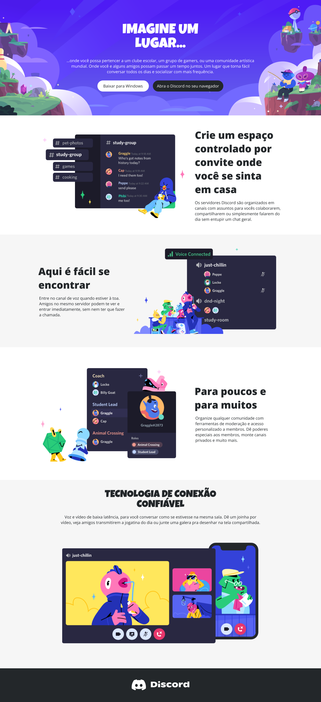

# Desafio 04: Recriando a Home do Discord com Responsividade

Bem-vindo(a) ao quarto desafio da Trilha de CSS da DIO! Neste desafio, você vai colocar a mão na massa e construir a página inicial do Discord, colocando em prática todos os conceitos aprendidos, principalmente sobre **Responsividade no CSS**.

## 📝 Sobre o Desafio

Este projeto foi construído **do zero**, desde a estrutura HTML até a estilização CSS, aplicando os conhecimentos adquiridos ao longo da trilha. O objetivo foi recriar a interface da página inicial do Discord, focando em:

- **Responsividade (Mobile First):** Criação de `@media queries` para adaptar o layout em tablets (≤1024px) e celulares (≤768px), empilhando as seções e ajustando os tamanhos de fonte.
- **Flexbox:** Utilizado no Header (botões), nas seções (imagem + texto) e no Footer para alinhar os elementos de forma precisa.
- **Unidades Relativas:** Uso de `%`, `max-width` e `flex: 1` para garantir que o layout flua em qualquer tamanho de tela, sem larguras fixas.
- **Background Image:** Uso de `background-size: cover` no header para que a imagem de fundo se adapte a qualquer resolução.
- **Tipografia Personalizada:** Importação das fontes `Luckiest Guy` (títulos) e `Open Sans` (textos) do Google Fonts, idênticas ao protótipo.
- **Ícones SVG:** Uso do logo do Discord em SVG inline no footer, evitando dependência de arquivo externo.
- **Organização de Arquivos:** Estrutura de pastas com `assets` para imagens, `index.html`, `style.css` e `README.md`.

[Link do Figma](https://www.figma.com/design/NRBYrG5d4DSzObv7dpTqoM/Desafio-Responsividade---DIO?node-id=1-56&t=FUPXRiQ9UyWwd8jh-0) contendo o protótipo do desafio para que você possa se basear.

*Observações: para aplicar os textos em gradiente, utilize a propriedade CSS `background-clip`, porém, para funcionar em alguns navegadores, é necessário utilizar a propriedade `-webkit-background-clip: text;`*